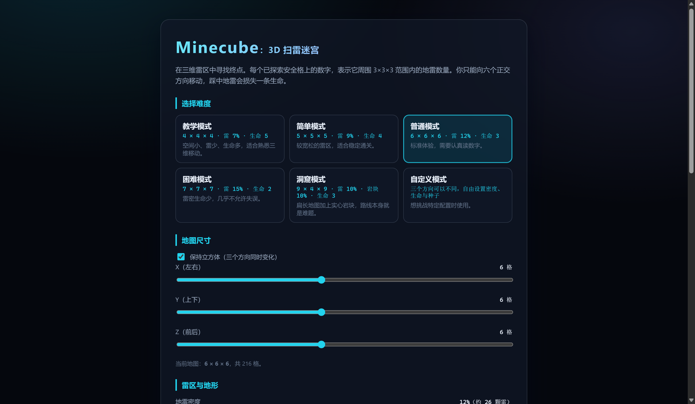
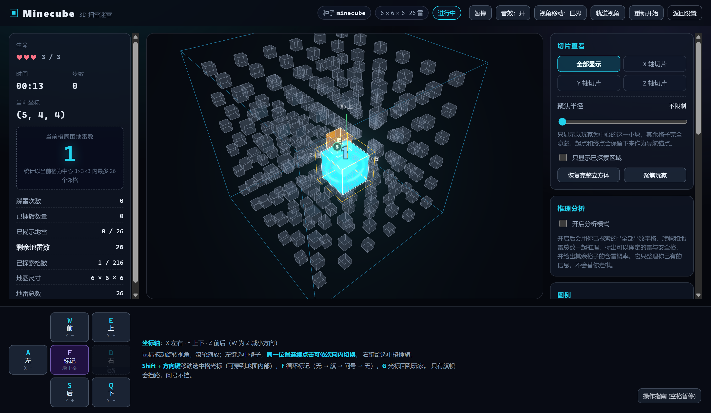
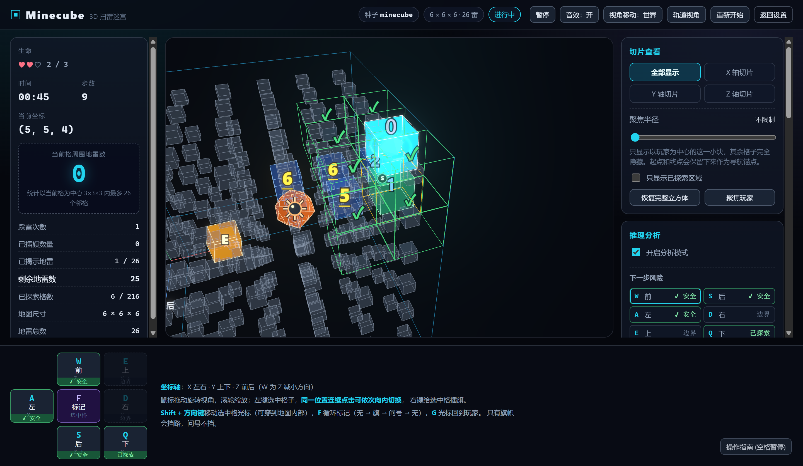
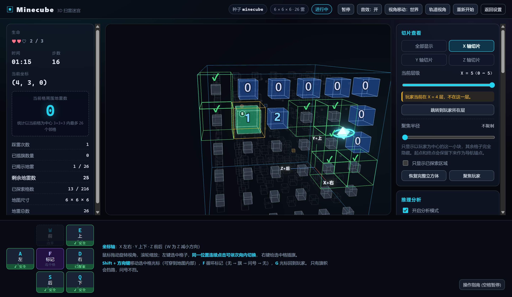
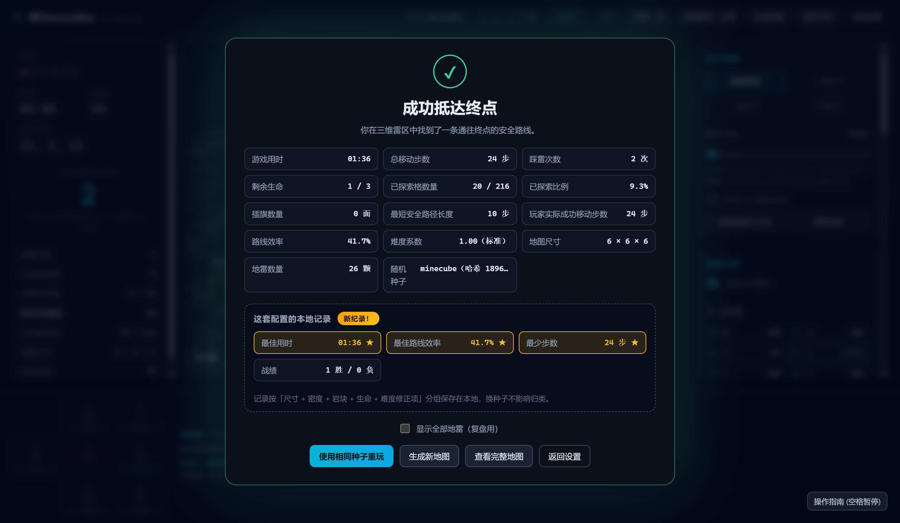
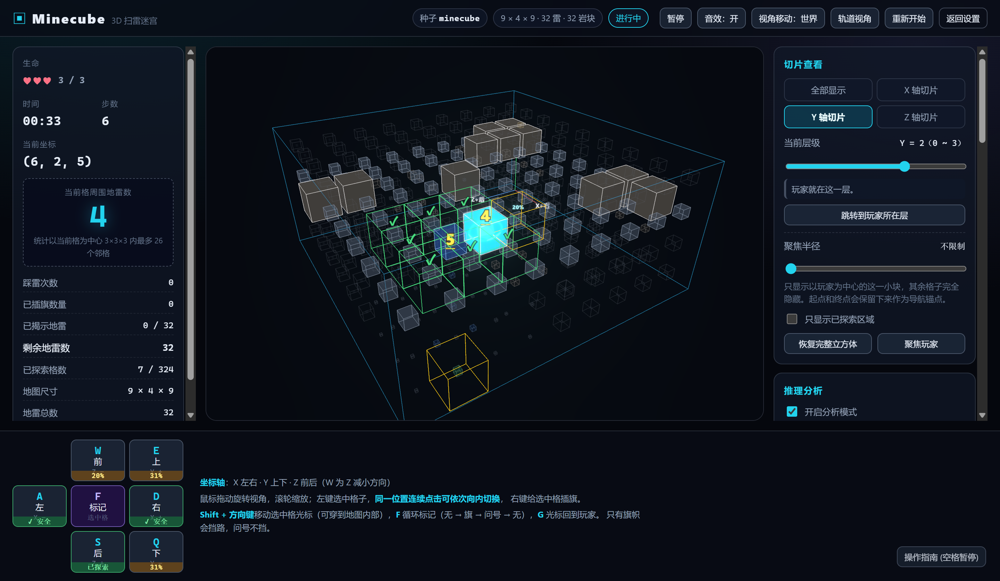

# Minecube：3D 扫雷迷宫

[🎮 在线试玩，无需安装](https://clayallan.github.io/MineCube/)

## 游戏截图

<table>
  <tr>
    <td width="50%"></td>
    <td width="50%"></td>
  </tr>
  <tr>
    <td width="50%"></td>
    <td width="50%"></td>
  </tr>
  <tr>
    <td width="50%"></td>
    <td width="50%"></td>
  </tr>
</table>

在一个三维雷区中寻路。每个已探索的安全格会显示它周围 3×3×3 区域内的地雷数量，
你需要靠这些数字推断风险，从起点走到终点。踩中地雷会损失一条生命，生命耗尽即失败。

浏览器中运行，无后端、无登录、无云端存档，全部状态保存在内存中。

---

## 一、游戏介绍

- 地图是一个长方体网格，**三个方向的尺寸各自独立（3~10），不要求是立方体**。
  每个格子可能是普通安全格、地雷、实心岩块、起点或终点。
- 玩家从起点出发，只能沿六个正交方向移动。
- 每进入一个安全格，就会永久显示该格的 **26 邻域地雷数**（0~26）。
- 不需要清除所有地雷，也不需要揭开所有格子；只要在生命耗尽前抵达终点即获胜。
- 每张地图在生成时都经过 BFS 校验，**保证起点到终点一定存在只经过可通行格的安全路径**。
- 内置**推理引擎**：用你已探索的全部数字、旗帜和地雷总数一起做约束求解，标出可以确定的雷与安全格，
  并给出其余格子的**精确含雷概率**；六个移动方向的风险直接显示在按钮上。
  它只整理你已有的信息，不会替你走棋。

## 二、玩法规则

### 移动

只能向六个正交方向移动，不能斜向移动：

```
(x±1, y, z)   (x, y±1, z)   (x, y, z±1)
```

移动到地图范围外时不执行移动，并给出提示。

### 地雷数字

进入安全格后，统计满足以下条件的邻格中的地雷数量（排除当前格自身）：

```
|x2 - x1| <= 1 且 |y2 - y1| <= 1 且 |z2 - z1| <= 1
```

内部格最多 26 个邻格，面上 17 个，棱上 11 个，角上 7 个。数字一经显示便永久保留。
数字越大，字体越重并附加下划线标记 —— 颜色不是唯一的区分手段。

**岩块不是地雷，不会被计入任何格子的数字**，但它会减少未知邻格的数量，因此反而有助于推理。

难度修正项「额外显示六邻域雷数」开启后，每个已探索格会再显示一个**只统计 6 个正交邻格**的数字
（右下角蓝色角标）。它约束强得多，而且直接对应你能走的六个方向，是让立方体内部真正可推理的关键。

起点从开局就是已探索状态，所以它会同时显示**数字和左上角的 `S` 角标**；玩家所在格的数字浮在
玩家标记上方。终点默认只显示 `E`（它的邻域雷数属于尚未获得的信息），可以通过难度修正项打开。

### 探索迷雾

游戏开始时只有起点、终点、岩块和玩家位置可见，其余格子为半透明的未探索状态，地雷与数字全部隐藏。
（终点是否可见、开局是否预先探索一圈，都可以通过难度修正项调整。）

### 实心岩块

岩块是一种可选的地形：

- **不是地雷**：撞上去不扣血，也不计入任何格子的邻域雷数；
- **从开局就完全可见**：它是唯一完全不透明的格子，与半透明的雷区格子一眼可分；
- **永远挡路**：BFS 把它和地雷一样当作不可通行格，生成时会保证绕开它仍然存在安全路径；
- **成簇生成**：随机撒点后沿六方向生长若干格，比纯随机散点更像天然地形。

岩块密度默认为 0（不生成），可以在自定义模式里开启，或直接选「洞窟模式」。

### 生命与踩雷

尝试进入地雷格时：

1. 损失 1 条生命；
2. **玩家不进入该格，仍停留在原地**；
3. 该地雷被永久揭示，此后视为不可通行障碍（再次撞上不会重复扣血）；
4. 该格上的旗帜自动移除；
5. 踩雷次数 +1，并伴随震动与爆炸音效。

生命降到 0 时立即失败，禁止继续移动，并揭示全部地雷方便复盘。

### 标记（旗帜 / 问号）

右键点击格子或按 `F` 会按**三态循环**切换标记：`无 → 旗 → 问号 → 无`。

| 标记 | 含义 | 计入剩余雷数 | 阻挡移动 | 推理引擎 |
| --- | --- | --- | --- | --- |
| 旗 ▲ | 断言「这里有雷」 | 是 | 是 | 当作雷 |
| 问号 ? | 「我拿不准」 | 否 | 否 | 仍然当作未知格 |

- 只能给未探索格做标记，已探索安全格、岩块、已揭示地雷、起点与（可见的）终点都不能标记。
- 插旗只是玩家的主观标记，游戏过程中系统不会确认对错。
- **HUD 的「剩余地雷数」= 地雷总数 − 已插旗 − 已揭示**，插旗后立刻减少（标准扫雷计数）。
  问号不参与这个计数。这个口径和推理引擎用的全局雷数约束完全一致。
- **插旗格不可直接进入，必须先取消旗帜**（避免误踩）；问号格可以直接走进去。
- 走进一个格子或踩到雷时，它上面的标记会被自动清掉。
- 终点被难度修正藏起来时，它在玩家眼里就是普通未探索格，**可以插旗** ——
  否则「这一格插不了旗」本身就泄露了终点位置。

### 终点

终点本身一定是安全格，进入即获胜。默认从开局就显示位置；
关闭「显示终点位置」后，HUD 会改为显示到终点的曼哈顿距离作为方向提示。
**一局结束后终点位置无条件显示**，便于复盘。

### 揭示阶段的旗帜判定

失败时（或胜利后打开「显示全部地雷」）会同时展示旗帜和地雷，让你一眼看出旗标得对不对：

| 状态 | 外观 | 含义 |
| --- | --- | --- |
| 旗标对了 | 绿色锥体 + ✓ | 你插了旗，那里确实有雷 |
| 旗标错了 | 红色锥体 + ✗ | 你插了旗，但那里没有雷 |
| 漏掉的雷 | 橙色多面体 | 你没标出来的雷（踩过的雷旗帜已被自动清掉，也归到这一类） |

### 推理分析

开启分析模式后，引擎会自动用**全部已探索格**做约束求解，不需要手动选任何东西。

**为什么三维扫雷需要这个**：2D 扫雷一个数字管 8 格，3D 一个数字管 26 格。按 12% 雷密度算，
一个格子数字为 0 的概率在角上是 41%、在面上是 11%、**在内部只有 3.6%** ——
单看一个「5 / 26 未知」几乎推不出任何东西。所以三维扫雷必须靠全局约束和概率，
而不是靠逐个数字心算。（顺带一个结论：贴着表面走在信息上更划算。）

引擎做三件事：

1. **确定性推理**，迭代到不动点：
   - **基本规则**：剩余雷数为 0 → 未知邻格全安全；剩余雷数等于未知邻格数 → 全是雷；
   - **子集规则**：若约束 A 的未知集是 B 的子集，则差集 `B\A` 中恰好有 `B.mines − A.mines` 颗雷，
     为 0 时全安全，等于差集大小时全是雷（涵盖经典的 1-2-1 等花样）；
   - **全局雷数规则**：HUD 上的地雷总数本来就是公开信息，剩余雷数用完 → 其余全安全；
     剩余雷数等于剩余未知格数 → 其余全是雷。
2. **精确概率**：把约束按共享格子分成连通分量，在分量内回溯枚举所有合法布雷方案，
   再用「剩余雷数分配到分量外未知格」的组合数加权，得到**精确的边缘概率**（不是估计）。
   分量过大或搜索超出节点预算时才退回局部估计，此时界面会明确提示「部分区域是估计值」。
3. **六方向风险**：把结论直接翻译成六个移动方向的可行性与风险，显示在移动按钮和面板上，
   并给出推荐的下一步。这是玩家每回合真正要做的决策。

**聚焦线索**是可选的透镜：点击已探索的数字格把它加入聚焦，可以单独查看这几格邻域的重叠区域
（并可只显示重叠区域）。聚焦**不影响推理范围**。

推理**只使用玩家已经拥有的信息**：已探索格的数字、玩家自己插的旗帜、已揭示的地雷、地形和地雷总数。
它会把你的旗帜当成雷，所以旗帜插错，结论也会错。绿色 ✓ 和红色 ✗ 是确定结论，百分比是含雷概率。

## 三、操作方式

```
W / S：前后移动（Z 轴，W 为 Z 减小方向）
A / D：左右移动（X 轴）
Q / E：上下移动（Y 轴，E 向上、Q 向下）
Shift + 方向键：移动「选中格光标」，不移动玩家
F：循环切换选中格的标记（无 → 旗 → 问号 → 无）
G：把选中格光标移回玩家位置
空格 或 P：暂停 / 继续
顶栏「视角移动」按钮：在「世界」与「相对」之间切换（相对模式下 W = 远离相机）
顶栏「轨道视角 / 第一人称」按钮：切换主视图模式
第一人称下 — 拖动鼠标环顾，← / → 原地转身 90°，W/S/A/D 相对镜头移动，Q/E 仍是世界上下
鼠标拖动：旋转视角
鼠标滚轮：缩放
鼠标左键：选中格子；同一位置连续点击会沿射线依次向内切换
鼠标右键：循环切换该格的标记（无 → 旗 → 问号 → 无）
```

### 如何选中立方体内部的格子

射线拾取只能命中最外层的方块，所以内部格有三种选法：

1. **选中格光标**：`Shift + WASDQE` 移动光标，它可以自由穿过任何格子，`F` 切换标记，`G` 回到玩家；
   右侧「选中格信息」面板里也有对应的方向盘按钮。
2. **深度穿透点击**：在同一屏幕位置连续左键点击，选中格会沿射线一层层往里走。
3. **切片查看**：选定某个轴后层外格子不参与拾取，该层内的任意格子都能直接点到。

玩家移动**不会**改变选中格 —— 选中格是你自己控制的光标。

坐标轴约定为 **X 左右、Y 上下、Z 前后**，界面右侧图例、底部按钮和 3D 场景角落的坐标轴指示器都会同步显示这一对应关系。
不使用键盘时，底部的六方向按钮可以完成全部移动操作。

### 第一人称视角

顶栏可以在**轨道视角**和**第一人称**之间切换：

- 镜头站在玩家所在格的中心，FOV 78°，近处浓雾（1.5~9 格）营造闯关时「看不远」的压迫感；
- 拖动鼠标环顾四周，`←` / `→` 原地转身 90°（吸附到正方向）；
- **移动强制相对镜头**：`W` 永远是「我正对着的方向」，底部按钮会实时显示它当前对应的世界轴；
- 玩家自身的格子与标记会隐藏，否则镜头会卡在方块里；
- 屏幕中央有准星，顶部有朝向罗盘。

配合聚焦半径 1（只看 3×3×3）就是纯粹的摸黑闯关；把聚焦半径调回「不限制」则更像在雷区里巡视。

### 分层查看

完整立方体会互相遮挡，因此「切片查看」是核心功能：

- **聚焦半径**：只显示以玩家为中心的 3×3×3 / 5×5×5 / 7×7×7，其余格子完全隐藏
  （起点和终点作为导航锚点保留）。这是最直接的「只看身边」模式；
- 可以选择 `全部显示 / X 轴切片 / Y 轴切片 / Z 轴切片`；
- 选定轴后用滑块选择 `0 ~ n-1` 层，当前层正常显示，其他层降到极低透明度作为空间参考；
- 玩家不在当前层时会给出提示，并可一键「跳转到玩家所在层」；
- 另有「只显示已探索区域」「恢复完整立方体」「聚焦玩家」。

## 四、技术栈

| 用途 | 技术 |
| --- | --- |
| 框架 | React 19 |
| 语言 | TypeScript（strict） |
| 构建 | Vite |
| 3D 渲染 | Three.js + @react-three/fiber + @react-three/drei |
| 测试 | Vitest |
| 样式 | 结构化的全局 CSS |
| 音效 | Web Audio API（程序化合成，无音频资源） |

没有后端服务，没有任何外部字体、贴图或模型依赖：3D 中的数字、S/E 标记、旗帜和地雷图标全部由 Canvas 2D 程序化绘制成贴图。

## 五、安装、启动、测试、构建

```bash
npm install
```

启动开发服务器（默认 http://localhost:5173）：

```bash
npm run dev
```

运行测试：

```bash
npm run test
```

类型检查：

```bash
npm run typecheck
```

生产构建（会先执行 `tsc --noEmit`）：

```bash
npm run build
```

本地预览构建产物：

```bash
npm run preview
```

## 六、项目结构

```text
src/
  game/                 纯逻辑层（不依赖 React 与 Three.js）
    types.ts            Position / Dims / Cell / GameMap / GameState 等核心类型
    constants.ts        方向表、难度预设、取值上限、难度系数计算
    seededRandom.ts     种子哈希 + Mulberry32 确定性 PRNG
    neighbors.ts        索引换算、六方向邻居、26 邻域、邻域雷数统计
    pathfinding.ts      六方向 BFS：连通性判断与最短安全路径
    mapGenerator.ts     地图生成（含岩块）、参数校验与规范化
    analysis.ts         推理引擎：全局约束、基本/子集/全局雷数规则、分量枚举精确概率
    risk.ts             把推理结论翻译成六个移动方向的风险与推荐下一步
    cameraRelative.ts   相机朝向吸附、第一人称偏航角、按键到世界方向的映射
    records.ts          本地最佳记录（配置签名、成绩累积）
    gameReducer.ts      游戏状态机（移动、踩雷、标记、光标、切片、聚焦、分析、计时）
    selectors.ts        派生数据：统计、格子视觉状态
  components/           React 组件
    GameBoard3D.tsx     3D 主视图（轨道 / 第一人称相机、灯光、切片、合并线框、分析浮标）
    CellCube.tsx        单个格子（方块 + 描边 + 标签 + 射线穿透链）
    GameScreen.tsx      游戏页面布局
    GameHUD.tsx         生命、时间、步数、当前坐标与数字
    LayerControls.tsx   切片查看面板
    AnalysisPanel.tsx   推理分析面板
    MovementControls.tsx 六方向按钮（带风险提示）+ 标记
    Legend.tsx          图例
    CellInspector.tsx   选中格信息 + 光标方向盘
    StartScreen.tsx     开始界面（尺寸、地形、难度修正项）
    EndScreen.tsx       胜负结算
    ErrorBoundary.tsx   React 错误边界
  render/               渲染资源（与游戏逻辑解耦）
    theme.ts            各状态的形状 / 尺寸 / 颜色 / 透明度定义
    labelTextures.ts    Canvas 2D 程序化生成的标签贴图
    resources.ts        共享几何体、材质缓存、线框合并
    webgl.ts            WebGL 支持检测
  hooks/                计时、键盘、本地存储、最佳记录
  audio/sfx.ts          Web Audio 音效
  styles/index.css      全局样式
  tests/                Vitest 单元测试
  App.tsx / main.tsx
```

游戏逻辑与渲染完全解耦：`src/game/` 下的所有模块都是纯 TypeScript，可以脱离浏览器单独测试。

## 七、地图生成机制

1. 把种子（数字或短字符串）通过 FNV-1a 哈希成 32 位整数，用它初始化 **Mulberry32** PRNG；
   地图生成的每一步随机都来自这个 PRNG，**完全不使用 `Math.random()`**。
2. 随机挑选起点与终点，要求：
   - 两者不同；
   - 曼哈顿距离 ≥ `min(floor(平均边长 × 1.5), 地图能提供的最大距离)`；
   - 各自至少有两个六方向邻格。
3. 把起点、终点以及各自随机保留的 **2 个六方向安全出入口**标记为受保护格，永不放雷也不放岩块。
4. 数量为 `round(格数 × 密度)`，若可放置位置不足会自动下调，而不是崩溃。
5. **先撒成簇的岩块**（随机撒点 + 沿六方向生长），再在剩余候选格中做种子化 Fisher-Yates
   洗牌并取前若干个作为地雷。
6. 用 BFS 检查连通性（**岩块和地雷都算障碍**），不通过就重来，最多重试 **100 次**。
7. 仍然失败时进入后备方案（见下）。
8. 最后一次性预计算所有格子的 26 邻域地雷数字（岩块不计入），并用 BFS 计算最短安全路径长度。

### 可通关性如何保证

- **主路径**：每次候选布局都必须通过「起点 → 终点、只经过可通行格、六方向」的 BFS 检查，不通过就重来。
- **后备方案**：连续 100 次失败后，先用随机化走法生成一条从起点通往终点的安全路径
  （优先选择缩短曼哈顿距离的方向，并以 25% 的概率随机绕行，因此路径有一定曲折度；走进死角时回溯，
  极端情况下退化为轴对齐路径），把整条路径连同起终点周边的缓冲区锁定为安全格，再在其余位置放岩块和雷，
  最后再做一次 BFS 校验。
- 所有循环都有明确的次数上限，**地图生成不会进入无限循环**。

目前只保证「地图在物理意义上存在安全路径」，**不保证每张地图都能在完全不猜的情况下用纯扫雷逻辑推理出来** ——
多条生命的设计正是为了让玩家在信息不足时能承担有限风险。

## 八、随机种子说明

- 种子既可以是数字（如 `20260727`），也可以是短字符串（如 `minecube`、`雷区`）。
- 字符串会通过 FNV-1a 稳定哈希成数字；纯数字字符串直接按数字使用。
- **相同的「地图尺寸 + 地雷密度 + 岩块密度 + 随机种子」一定生成完全相同的地图**：
  相同的起点、终点、岩块与地雷布局、相同的数字。
- **难度修正项不影响地图生成**，只影响玩家能看到多少信息 —— 同一个种子换难度修正项，地图布局完全一致。
- 结算界面会显示本局种子，「使用相同种子重玩」可以在同一张地图上重来。
- 玩家最后一次的设置会保存在 `localStorage`（读写失败时静默回退到默认配置）。
- 本地最佳记录同样保存在 `localStorage`，按配置签名分组，**种子不参与签名**。

## 九、难度设置

### 预设

| 模式 | 尺寸 | 地雷密度 | 岩块 | 生命 | 修正项 |
| --- | --- | --- | --- | --- | --- |
| 教学模式 | 4 × 4 × 4 | 7% | — | 5 | 预探索 1 格、显示终点数字 |
| 简单模式 | 5 × 5 × 5 | 9% | — | 4 | 预探索 1 格 |
| 普通模式 | 6 × 6 × 6 | 12% | — | 3 | 基准配置 |
| 困难模式 | 7 × 7 × 7 | 15% | — | 2 | 基准配置 |
| 洞窟模式 | 9 × 4 × 9 | 10% | 10% | 3 | 基准配置 |
| 自定义 | 每轴 3 ~ 10 | 5% ~ 20% | 0% ~ 15% | 1 ~ 9 | 自由组合 |

自定义模式的三个方向可以互不相同（可勾选「保持立方体」让它们同步变化），
界面会实时显示总格数、实际地雷与岩块数量。

### 难度修正项

这些开关不改变地图本身，只改变玩家能拿到多少信息：

| 修正项 | 效果 | 系数 |
| --- | --- | --- |
| 隐藏终点位置 | HUD 改为显示到终点的曼哈顿距离 | × 1.35 |
| 显示终点格的数字 | 提前知道终点附近的雷数 | × 0.92 |
| 额外显示六邻域雷数 | 每格再给一个「6 个正交邻格里有几颗雷」的数字 | × 0.75 |
| 开局预探索半径 1 | 起点周围 3×3×3 的安全格直接可见（地雷仍隐藏） | × 0.85 |
| 开局预探索半径 2 | 起点周围 5×5×5 | × 0.72 |
| 禁用推理分析面板 | 只能自己心算 | × 1.12 |

**难度系数**以普通模式的默认配置为 `1.00`，按乘法叠加尺寸、密度、生命、岩块与上述修正项，
显示在开始界面和结算界面，方便横向比较不同配置的难度。

## 十、结算统计

胜利或失败后会显示：游戏用时、总移动步数、踩雷次数、剩余生命、已探索格数量与比例、插旗数量、
最短安全路径长度、玩家实际成功移动步数、路线效率、难度系数、地图尺寸、地雷与岩块数量、随机种子。

下方还会显示**这套配置的本地最佳记录**（最佳用时、最佳路线效率、最少步数、胜负场次），
刷新纪录的项目会标上 ★ 并显示「新纪录！」。记录按「尺寸 + 密度 + 岩块 + 生命 + 难度修正项」分组，
换种子不影响归类；开始界面也会显示当前配置的记录。

路线效率定义为：

```
路线效率 = 最短安全路径长度 / 玩家实际成功移动步数   （限制在 0% ~ 100%）
```

有回头路时效率会下降。最短路径长度在游戏过程中不显示，以免泄露地图信息。

## 十一、测试

`npm run test` 运行 Vitest（当前 11 个文件、206 个用例），覆盖以下纯逻辑：

- **邻居计算**：内部格 26 个探测邻居、角落格 7 个、六方向邻居数量、不返回地图外坐标、
  非立方体地图上每个轴独立判定边界；
- **地雷数字**：26 邻域统计正确、不统计自身、边界格正确、上限 26；
- **六邻域数字**：只统计 6 个正交邻格、斜向不计入、角落格上限 3、生成时预计算且不超过 26 邻域数；
- **随机种子**：相同种子生成相同序列/地图，不同种子结果不同，空种子有稳定兜底；
- **BFS**：最短路径长度、绕开地雷与岩块、被包围时不可达；
- **地图生成**：8 种形状 × 6 个种子的硬性约束、起终点不是地雷、必定存在安全路径、
  数量合理、起终点各保留至少两个可通行出入口、极扁地图、极端参数不崩溃也不死循环；
- **岩块**：默认不生成、开启后仍可通关、不计入任何数字、不占据起终点、总数不超过可放置格数；
- **移动**：安全移动更新位置、越界无效、踩雷位置不变且扣血、地雷被揭示、岩块挡路但不扣血、
  生命归零失败、抵达终点胜利、结束后输入被忽略；
- **标记**：三态循环（无 → 旗 → 问号 → 无）、已探索安全格与岩块不可标记、插旗格不可直接进入、
  问号不挡路也不计入剩余雷数、走进格子会清掉标记、越界不崩溃、
  插旗后剩余地雷数减少且取消后恢复、踩雷清旗后不会重复扣减；
- **聚焦半径**：切比雪夫距离判定、半径 1 只留 3×3×3、起点终点作为锚点始终保留、
  0 表示不限制、与「只显示已探索区域」是同时满足的关系；
- **第一人称**：yaw = 0 对应 Z−、四个正方向与偏航角互相自洽、转 90° 依次经过前左后右、
  偏航角规范化与 90° 吸附、任意角度吸附后都对应合法方向；
- **揭示阶段**：插旗且确实是雷 = 标对、插旗但没雷 = 标错、没插旗的雷 = 漏掉，
  游戏进行中只显示普通旗帜不泄露对错；结算后终点无条件可见；
- **选中格光标**：移动玩家不会抢走光标、光标可穿到内部并插旗、边界钳制、一键回到玩家；
- **推理引擎**：无需手选线索的全局约束、聚焦只影响高亮不影响结论、基本规则、子集规则、
  全局雷数规则、跨约束迭代传播、六邻域开关确实带来更多确定结论、精确边缘概率
  （单约束下等于剩余雷数 / 未知格数）、枚举本身给出确定结论、矛盾检测、
  分析不修改地图、10×10×10 大地图在 3 秒内跑完；
- **六方向风险**：越界/岩块/旗帜/已揭示雷都不可通行、已探索与起终点是已知安全、
  隐藏终点时终点不再算已知安全、确定安全/确定有雷/概率三档、推荐下一步的优先级、
  全部堵死时返回 null；
- **相机相对移动**：朝向吸附、默认机位与世界模式一致、转到背面后前后左右整体翻转、
  上下始终是世界坐标、映射恒为六方向一一对应且前后与左右垂直；
- **本地记录**：种子不参与签名、其余参数都会改变签名、非立方体三轴不混淆、
  首胜记录三项、更好的成绩才刷新、失败只累加负场、不同配置互不干扰、不修改入参；
- **难度修正**：难度系数基准与单调性、预设系数递增、预探索范围与不揭示地雷、
  隐藏终点不通过插旗规则或「只显示已探索区域」泄露位置、分析开关的门禁；
- **切片与计时**：每个轴层级各自钳制、跳转玩家层、暂停停止计时且禁止移动；
- **统计**：路线效率范围与结算字段完整性。

## 十二、错误处理

- 非法的尺寸、密度、生命、空种子会在开始界面给出提示，并在生成前自动收敛到合法范围。
- 地图生成失败会返回设置界面并显示错误信息，而不是白屏。
- 不支持 WebGL 时显示明确提示，其余界面仍可使用。
- 全局与 3D 视图各有一层 React Error Boundary，单个渲染异常不会让页面变成空白。
- 键盘移动做了 110ms 节流，重复按键、快速连按都不会造成状态异常。
- 切片层级、结束状态下的输入、越界坐标操作都会被安全忽略。

## 十三、性能说明

- 最大地图 10 × 10 × 10 = 1000 格；超过 640 格时开始界面会给出性能提示。
- 地雷数字在地图生成时一次性预计算，游戏过程中不再重算。
- 所有格子共享同一份 `BoxGeometry` / `EdgesGeometry`，材质按「颜色 + 透明度」缓存复用。
- 未探索格（数量最多）的线框合并为单个几何体绘制，可省下数百个 draw call；
  拾取仍由每格独立的 Mesh 负责，交互逻辑不受影响。
- `CellCube` 使用 `memo` 且只接收原始值 props，父组件重渲染时会被跳过。
- 关闭阴影，动画循环中不创建临时对象，不加载任何外部纹理。
- 推理分析在 `useMemo` 里按线索列表缓存，只在线索或地图变化时重算。

## 十四、已知限制

- **不保证纯逻辑可解**：地图只保证物理上存在安全路径，某些局面可能需要猜测；多条生命是对此的补偿设计。
  引擎会明确告诉你「目前没有可以百分之百确定的格子」，此时只能按概率赌。
- **概率不总是精确的**：约束连通分量超过 26 格、或回溯搜索超过 40 万节点时会退回局部估计，
  界面会提示「部分区域是估计值」。实测中开启六邻域数字后分量通常很小，绝大多数情况是精确值。
- 推理会把**你插的旗帜当成雷**。旗帜插错，结论就会错 —— 引擎能检测出明显矛盾，但不能替你纠错。
- 默认移动方向基于世界坐标轴，把视角转到背面后 `W` 仍然是 Z 减小方向；
  顶栏的「视角移动」开关可以切到相机相对模式（`W` = 远离相机，`Q/E` 仍是世界上下）。
- 半透明方块不写深度，因此在「全部显示」模式下，远处已探索格的数字可能透过前面的格子被看到；
  这是为了让内部可读而做的取舍，配合切片查看可以获得清晰视图。（岩块是唯一完全不透明的格子，
  会正常遮挡。）
- 移动端只做了基础的响应式布局，触摸操作没有专门优化。
- 音效为程序化合成的简单音色，没有背景音乐。
- 没有进度存档（只有最佳成绩记录）、在线排行榜与联机。
- 大地图（接近 1000 格）在低端集成显卡上可能达不到满帧；如需进一步优化，可改用 `InstancedMesh`。

## 十五、未来可以扩展的功能

- **纯逻辑可解的地图生成**：生成后用现有求解器从起点模拟一遍，若某步必须靠猜就重新生成或改一颗雷的位置。
  这是对公平性提升最大的一件事，也能直接消化掉上面「不保证纯逻辑可解」那条限制。
- 每日挑战（按日期作为固定种子）
- 分享码：地图完全由「尺寸 + 密度 + 岩块 + 种子」决定，一个短字符串就能复现整张图
- 回放系统（一局 = 配置 + 种子 + 操作序列，数据量极小，还能做「这一步当时能不能推出来」的复盘）
- 地图编辑器
- 更复杂的地形：单向通道、传送门、任意形状的虚空格
- 多目标点（必须依次经过 A → B → 终点）与路径轨迹可视化
- 更多视觉主题与配色方案
- 移动端触控适配与手势操作
- 成就系统
